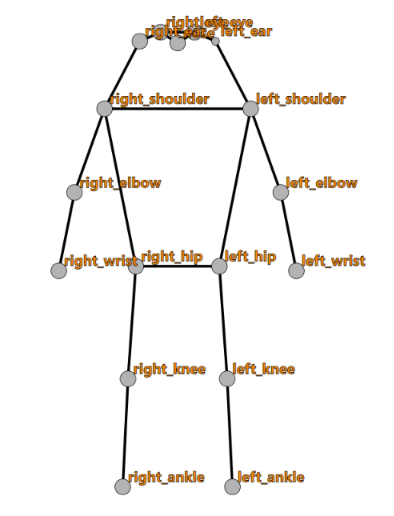
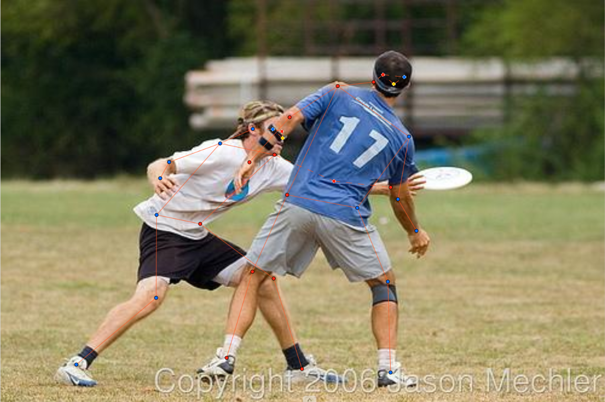
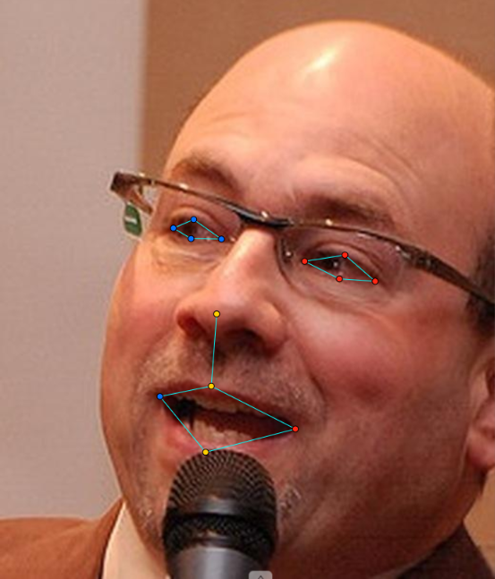
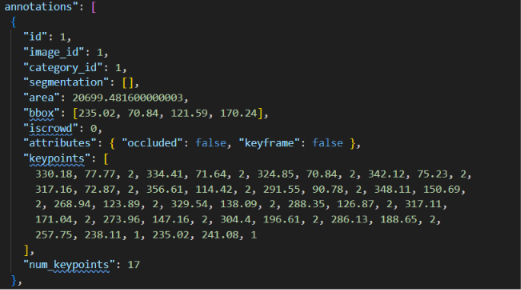

# Báo cáo cá nhân — Bùi Kim Trai — 2A202603176

> Bộ nộp hiện tại gồm **20 skeleton người chính / 12 ảnh**, **8 mặt / 8 ảnh**, **9 skeleton người Bonus B1 / 3 ảnh** và **5 mặt Bonus B2 / 5 ảnh**. Báo cáo có đủ mục 0–8, tài liệu tham khảo, kết quả tự kiểm và bốn ảnh minh chứng. Hai cảnh báo B1 được giữ nguyên kèm giải thích; chữ vùng đầu trong ảnh label person còn chồng nhau, được ghi rõ tại mục 6.

Dữ liệu: COCO 2017 train/val và các ảnh mặt cắt từ COCO theo bộ ảnh riêng trong `assignment.json`. Thực hiện trên CVAT local; không kèm ảnh gốc trong file xuất.

## 0. Thông tin học viên

- Họ tên: **Bùi Kim Trai**.
- MSSV: **2A202603176**.
- Email: buikimtrai2k5@gmail.com.
- Repository: [K5-L2A-Day04-BuiKimTrai-2A202603176-KeypointPose-Student](https://github.com/KtraiVla/K5-L2A-Day04-BuiKimTrai-2A202603176-KeypointPose-Student).
- CVAT: **2.74.1**, đọc trực tiếp từ CVAT đang chạy tại lần kiểm tra.
- Máy: Acer Nitro AN515-45, Windows 11 Pro, Ryzen 7 5800H, RAM 16 GB, RTX 3070 Laptop 8 GB.
- CVAT chạy đầy đủ các dịch vụ tại lần kiểm tra.
- Bộ ảnh riêng: có [assignment.json](../../src/exports/assignment.json), MSSV và danh sách ảnh khớp hàm chia bộ ảnh của lab.
- Buổi làm bài học viên cung cấp: **16:30–19:30 ngày 12/11/2026 (GMT+7)**, tổng **180 phút**. Các lượt rà/sửa và xuất lại được thực hiện sau buổi; không có số liệu thời gian tách riêng để tự cộng thêm hoặc phân bổ theo CP.

## 1. Kiểm tra label (CP0)

| Label | Kiểu | Số điểm | Tên điểm đúng bảng lab | Đúng thứ tự | Số cạnh |
|---|---|---:|---|---|---:|
| `person` | Skeleton | 17 | Có | Có | 19 |
| `face` | Skeleton | 13 | Có | Có | 13 |

Đã đối chiếu tên, thứ tự và cạnh trong JSON với `src/keypoint_schema.json`, đồng thời đọc số điểm của label trên CVAT. Mẫu `person` dựng theo người quay mặt về camera, các điểm `left_*` ở bên phải khung mẫu.

Theo hướng dẫn thao tác của lab, rê chuột đúng một điểm rồi dùng **Q** để bật/tắt `occluded`, **O** để bật/tắt `outside`; cũng có thể mở menu của điểm. `hidden` chỉ ẩn hiển thị, không thay thế cờ visibility trong bản xuất. Điểm `outside` xuất ra `v=0`, `occluded` xuất ra `v=1`, điểm nhìn thấy là `v=2`.

## 2. Số lượng đã gán và thời gian (CP1, CP2)

| Nhóm ảnh | Số ảnh | Số skeleton trong bản xuất | Người dưới 60 px không gán | Poster/gương/màn hình bỏ qua | Thời gian theo nhóm |
|---|---:|---:|---|---|---|
| `easy` | 5 | 5 | Không có thống kê riêng | Không có thống kê riêng | Không có số liệu riêng |
| `occluded` | 3 | 7 | Không có thống kê riêng | Không có thống kê riêng | Không có số liệu riêng |
| `back` | 2 | 4 | Không có thống kê riêng | Không có thống kê riêng | Không có số liệu riêng |
| `small` | 1 | 1 | Không có thống kê riêng | Không có thống kê riêng | Không có số liệu riêng |
| `crowd` | 1 | 3 | Không có thống kê riêng | Không có thống kê riêng | Không có số liệu riêng |
| `faces` | 8 | 8 | — | Không có thống kê riêng | Không có số liệu riêng |

- Tổng phần người: **12 ảnh, 20 skeleton**, gồm easy=5, occluded=7, back=4, small=1, crowd=3. Đã bổ sung người áo xanh ở **000000461389.jpg**; số lượng skeleton hiện khớp con số 20 người của đề bài. Phần cờ/vị trí vẫn được rà riêng ở mục 4.
- Ảnh **000000381889.jpg** hiện giữ 3 skeleton. Khoảng trải điểm 19 px của người nền trong bản trước không chứng minh chiều cao thật dưới 60 px. Tổng hiện tại là 20 sau khi bổ sung người ở 000000461389.jpg; số lượng tổng không thay thế việc kiểm đủ người theo từng ảnh.
- Tổng phần mặt: **8 ảnh, 8 skeleton**, mỗi mặt 13 điểm.
- Mốc phút 105 và thời gian riêng CP1/CP2/CP3: không có số liệu riêng trong báo cáo; chỉ ghi tổng 180 phút học viên đã xác nhận.
- Những ảnh tốn nhiều thời gian và lý do: Các ảnh học viên xác nhận tốn nhiều thời gian gồm 000000043500.jpg, 000000381889.jpg và 000000469061.jpg. Nguyên nhân là nhiều người hoặc hai người đứng sát nhau, các bộ phận bị che, quần áo dày/rộng làm khó thấy khớp nên phải cân nhắc vị trí ước lượng. Không có số phút riêng hoặc xếp hạng một ảnh duy nhất.
- Cột người nhỏ và đối tượng bỏ qua chưa có thống kê chính xác theo từng nhóm; không tự thay bằng số 0.

## 3. Bảng ca khó (CP1, CP2)

Nhận xét học viên cung cấp: bộ phận không rõ, người quay lưng, người ở xa và hai người đứng sát nhau khiến việc xác định điểm khó hơn. Với mặt, kính trong có thể vẫn nhìn rõ mắt; kính râm, ảnh mờ, ảnh đen trắng, cúi hoặc xoay mặt làm vị trí mắt khó xác định.

Nguyên tắc học viên đã nêu: bị khuất nhưng vẫn ước lượng được thì dùng occluded (v=1); không thấy và không ước lượng được thì dùng outside (v=0). Ước lượng cần đủ chắc chắn, không phải đoán cho đủ điểm.

Bảng được biên tập từ nhận xét học viên và đối chiếu cờ trong bản xuất hiện tại. Vị trí điểm và các trường hợp còn phân vân được theo dõi tiếp ở mục 4.

| Ảnh | Người / mặt | Điểm | Cờ trong file hiện tại | Phân vân giữa | Lý do / nội dung cần rà lại |
|---|---|---|---:|---|---|
| `000000043500.jpg` | Người quay lưng ở bậc tàu, annotation id 2 | `nose` | 0 | v=1 / v=0 | Không thấy mũi; phù hợp với nguyên tắc học viên nêu: không ước lượng chắc thì dùng outside. |
| `000000351176.jpg` | Người chơi tennis quay lưng, annotation id 10 | `left_eye` | 1 | v=1 / v=0 | Học viên đã tự kiểm và chủ động giữ v=1 vì cho rằng có cơ sở ước lượng đủ chắc; file xuất vẫn giữ occluded. Không ghi đây là lần đổi cờ. |
| `000000469061.jpg` | Người áo trắng phía sau, annotation id 19 | `left_hip` | 1 | v=1 / v=0 | Hai người đứng sát nhau, bộ phận bị che lấp; học viên cho biết dùng v=1 khi vẫn ước lượng được. |
| `000000469061.jpg` | Người áo xanh phía trước, annotation id 20 | `right_ear` | 0 | v=1 / v=0 | Tai không thấy rõ; file đang dùng outside, phù hợp nguyên tắc v=0 khi không ước lượng được. |
| `face_196742.jpg` | Mặt đeo kính trong, annotation id 3 | `left_eye_upper` | 2 | v=2 / v=1 | Học viên cho biết kính trong vẫn nhìn rõ mắt; điểm đang được gán nhìn thấy trong file. |
| `face_256814.jpg` | Mặt đeo kính râm, annotation id 4 | `left_eye_upper` | 1 | v=1 / v=0 | Ban đầu dùng v=0 vì khó xác định mắt sau kính. Sau khi xem lại quy tắc kính râm, đã cập nhật v=1; bản ZIP mới xác nhận cả 8 điểm mắt là occluded. |

**Kết quả cập nhật:** bản ZIP mới xác nhận cả 8 điểm mắt của face_256814.jpg là v=1 và num_keypoints=13. Cờ đã phù hợp quy tắc kính râm của lab; chưa có ground truth để kết luận mọi tọa độ đều chính xác.

## 4. Bảng tự review (CP3)

Bảng gồm **10 dòng cho 5 ảnh người và 3 ảnh mặt**; trong 5 ảnh người có 2 ảnh `back` (000000351176.jpg, 000000043500.jpg). Các quan sát được trợ lý hỗ trợ đối chiếu nhãn CVAT với ảnh gốc; học viên đã xác nhận kiểm lại năm dòng trước đây còn mở và cần giải thích được từng lựa chọn theo quy định lab. Mã ở cột lỗi được chuẩn hóa; phần còn phân vân nằm trong ghi chú/trạng thái.

| Ảnh | Người / mặt | Điểm | Mã lỗi | Ghi chú | Đã sửa? |
|---|---|---|---|---|---|
| `000000461389.jpg` | Người áo xanh phía sau người áo đỏ | Toàn bộ skeleton | `missing` | Đã bổ sung skeleton; ảnh hiện có 3 skeleton và toàn task có 20. | Có; xác nhận từ bản xuất mới |
| `000000461389.jpg` | Người áo xanh mới thêm | left_hip, right_hip | `vis_flag` | Đã đổi cả hai hông từ v=1 sang outside (v=0); các điểm gối/cổ chân giữ nguyên. num_keypoints=4; checker không còn cảnh báo sát mép. | Có; xác nhận từ bản xuất mới |
| `000000469061.jpg` | Người áo trắng phía sau | left_shoulder | `position` | Học viên đã kiểm/chỉnh; tọa độ hiện tại (311.15, 99.85), v=1. Đã có thay đổi trong ZIP; không kết luận trùng GT. | Đã kiểm/chỉnh theo xác nhận học viên |
| `000000469061.jpg` | Người áo trắng phía sau | right_eye | `vis_flag` | Đã đổi v=2 thành occluded v=1 cho mắt sau kính; bản xuất mới xác nhận cờ. | Có; đã xác nhận qua ZIP |
| `000000438099.jpg` | Người dùng laptop | left_eye, right_eye, left_hip | `vis_flag` | Hai mắt và hông trái đã đổi từ v=2 sang v=1; vị trí hông cũng được điều chỉnh trong bản xuất. | Có; đã xác nhận qua ZIP |
| `000000351176.jpg` | Người chơi tennis quay lưng | left_eye, right_eye | `ok` | Học viên xác nhận đã tự kiểm và chủ động giữ v=1 vì cho rằng ước lượng đủ chắc. Tọa độ/cờ không đổi trong bản ZIP mới. | Đã kiểm, chủ động giữ nguyên v=1 |
| `000000043500.jpg` | Người cúi đầu phía trong tàu | left_eye, right_eye | `vis_flag` | Sau khi kiểm, mắt trái giữ v=2, mắt phải đổi sang v=1; bản xuất mới xác nhận hai cờ khác nhau. | Có; đã kiểm và cập nhật cờ |
| `face_333134.jpg` | Mặt cúi xuống | Mí, khóe mắt, mũi, miệng | `ok` | Lượt rà soát hỗ trợ chưa phát hiện lỗi rõ. Tên trái/phải phù hợp; khi tinh chỉnh cần bám mép mí, không theo lông mi. | Không có sửa được ghi nhận |
| `face_79591.jpg` | Mặt nghiêng | Điểm mắt và miệng | `ok` | Lượt rà soát hỗ trợ chưa phát hiện lỗi rõ; left_eye_outer và mouth_left đang v=1 ở phía xa/bị che. | Không có sửa được ghi nhận |
| `face_256814.jpg` | Mặt đeo kính râm | 8 điểm mắt hai bên | `vis_flag` | Đã đổi outside (v=0) sang occluded (v=1). ZIP mới và nhãn CVAT đều xác nhận đủ 8 điểm v=1. | Có; đã xác nhận qua dữ liệu xuất |

Số **dòng ghi nhận** theo mã (không phải số lỗi đã xác nhận bằng GT):

| lr_swap | vis_flag | position | missing | extra | ok |
|---:|---:|---:|---:|---:|---:|
| 0 | 5 | 1 | 1 | 0 | 3 |

Đã đối chiếu năm dòng được học viên xác nhận tự kiểm: bốn dòng có thay đổi tọa độ/cờ trong ZIP, một dòng mắt người quay lưng chủ động giữ nguyên v=1. Các trường hợp bổ sung người áo xanh, hông outside và mắt kính râm đã được xác nhận trước đó. Ba dòng ok là kết quả quan sát/kiểm theo mô tả, không phải kết quả so với GT.

Nguyên tắc học viên áp dụng khi chốt: chỉ dùng v=1 khi ước lượng đủ chắc; không xác định được thì v=0. Mắt người quay lưng được giữ v=1 theo quyết định đã xác nhận của học viên.

## 5. Kiểm file xuất và kết quả tự kiểm (CP4)

Định dạng: **COCO Keypoints 1.0**, không kèm ảnh. Đã đọc JSON của 2 người và 1 mặt, đếm chiều dài mảng và kiểm `num_keypoints` bằng số bộ ba có v>0:

| File | Ảnh / annotation | Số phần tử keypoints | Phân bố cờ | num_keypoints |
|---|---|---:|---|---|
| BuiKimTrai_persons.zip | 000000021235.jpg, id 1 | 51 | v2=15; v1=2; v0=0 | 17, khớp |
| BuiKimTrai_persons.zip | 000000043500.jpg, id 3 | 51 | v2=12; v1=4; v0=1 | 16, khớp |
| BuiKimTrai_faces.zip | face_145751.jpg, id 1 | 39 | v2=13; v1=0; v0=0 | 13, khớp |

Ví dụ: left_ankle của người ở 000000021235.jpg là (257.75, 238.11, 1); left_ankle ở 000000043500.jpg là (169.1, 186.25, 0). Điểm outside có thể giữ tọa độ cũ trong CVAT 2.x; không sửa JSON để đưa về 0,0. Ví dụ này minh họa cách đọc (x, y, v): v=0 là outside, v=1 là occluded; chỉ các điểm v>0 được tính vào num_keypoints. Việc đọc/đếm JSON có hỗ trợ của công cụ như khai báo ở mục 9.

Tại lần rà soát cuối ngày **13/11/2026**, các job **13, 14, 15, 16** đều **completed**. Bốn ZIP khớp toàn bộ tọa độ sau làm tròn hai chữ số thập phân và cờ visibility với nhãn đang lưu trên CVAT. ZIP không chứa ảnh gốc; danh sách ảnh khớp bộ được tính lại từ MSSV trong assignment.json.

```text
----- TÓM TẮT (dán vào báo cáo mục 5) -----
- File person: BuiKimTrai_persons.zip
  Số ảnh: 12 · số skeleton `person`: 20 · mỗi annotation 51 số
  Skeleton theo ảnh: 000000021235=1, 000000043500=2, 000000157271=2, 000000196283=1, 000000294379=1, 000000295358=1, 000000351176=2, 000000365099=1, 000000381889=3, 000000438099=1, 000000461389=3, 000000469061=2
  Cờ v: v=2 237 (70%) · v=1 54 (16%) · v=0 49 (14%)
  num_keypoints trung bình: 14.6
- File face: BuiKimTrai_faces.zip
  Số ảnh: 8 · số skeleton `face`: 8 · mỗi annotation 39 số
  Skeleton theo ảnh: face_145751=1, face_147624=1, face_196742=1, face_256814=1, face_300399=1, face_333134=1, face_476363=1, face_79591=1
  Cờ v: v=2 92 (88%) · v=1 12 (12%) · v=0 0 (0%)
  num_keypoints trung bình: 13.0
- Ghi chú: 49 điểm v = 0 vẫn mang tọa độ cũ (CVAT 2.x xuất như vậy; chuẩn COCO ghi 0, 0). Không phải lỗi: điểm v = 0 bị bỏ qua khi huấn luyện và khi chấm.
- Số [LỖI]: 0 · số [CẢNH BÁO]: 0
Kết quả: ĐẠT
```

Bản xuất chính hiện có **0 lỗi, 0 cảnh báo** về kiểm tự động, gồm 20 skeleton người và 8 mặt. Cảnh báo hai hông sát mép trên đã được xử lý bằng outside. Checker không có GT; năm dòng review đã được học viên tự kiểm và được đối chiếu như mục 4; kết quả checker không thay thế chấm vị trí bằng GT.

## 6. Ảnh chụp màn hình

Đã lưu và chèn đủ bốn file PNG đúng tên. Đây là ảnh minh chứng do học viên cung cấp, không phải ảnh dựng lại bằng model. Ảnh 2 và 3 đã được đối chiếu với ảnh trong bộ giao; đoạn keypoints trong ảnh 4 khớp bản xuất hiện tại.

| File | Nội dung thực tế | Kết quả rà soát |
|---|---|---|
| 1_label_person.png | Mẫu skeleton person trong constructor | Có mẫu và tên điểm; chữ ở đầu/mắt/tai chồng nhau, nên chụp lại rõ hơn để đọc đủ 17 tên ngay trên ảnh |
| 2_nguoi_quay_lung.png | Hai người chơi đĩa bay trong 000000157271.jpg, người áo xanh số 17 quay lưng | Thấy nhãn, đường nối và các đoạn nét đứt của điểm bị che |
| 3_mat_phong_to.png | face_196742.jpg: người đeo kính trong cầm micro | Thấy đủ 13 điểm trên mắt, mũi và miệng, vùng mắt được phóng to |
| 4_json_export.png | Annotation id 1 của 000000021235.jpg trong ZIP người | Thấy mảng keypoints gồm 51 số và num_keypoints=17; khớp JSON hiện tại |

### 6.1. Label person



Nguồn: giao diện label constructor CVAT, mẫu person của lab. Mẫu dựng theo người quay mặt về camera; trái/phải theo người được gán. Do chữ vùng đầu chồng nhau, tên và thứ tự đầy đủ được ghi thêm bên dưới theo [schema của lab](../../src/keypoint_schema.json). Danh sách này hỗ trợ đọc báo cáo; ảnh nên được chụp rõ hơn nếu cần minh chứng trực tiếp từng tên.

| Thứ tự | Tên điểm | Thứ tự | Tên điểm |
|---:|---|---:|---|
| 1 | nose | 10 | left_wrist |
| 2 | left_eye | 11 | right_wrist |
| 3 | right_eye | 12 | left_hip |
| 4 | left_ear | 13 | right_hip |
| 5 | right_ear | 14 | left_knee |
| 6 | left_shoulder | 15 | right_knee |
| 7 | right_shoulder | 16 | left_ankle |
| 8 | left_elbow | 17 | right_ankle |
| 9 | right_elbow | — | — |

### 6.2. Người quay lưng đã gán



Nguồn ảnh: COCO 2017, 000000157271.jpg thuộc bộ giao; ảnh chụp nhãn trên CVAT của học viên. Người áo xanh số 17 quay lưng, có phần bị người phía trước che; ảnh thể hiện skeleton và các đoạn nét đứt. Không suy ra cờ chỉ từ màu điểm; cờ trong ZIP được kiểm riêng tại mục 5.

### 6.3. Khuôn mặt 13 điểm phóng to



Nguồn: ảnh mặt cắt từ COCO theo bộ ảnh lab, face_196742.jpg; ảnh chụp nhãn CVAT của học viên. Có bốn điểm mỗi mắt, đầu mũi và bốn điểm miệng/môi. Kính trong vẫn nhìn thấy mắt; cả 13 điểm của mặt này được xuất với v=2. Nguồn bộ ảnh và giấy phép được liệt kê tại [pool.json](../../src/lab/pool.json).

### 6.4. JSON xuất từ CVAT



Nguồn: annotations/person_keypoints_default.json trong BuiKimTrai_persons.zip, annotation id=1, image_id=1, ảnh 000000021235.jpg. Mảng gồm 17 bộ (x, y, v), tức 51 số: 15 điểm v=2, hai cổ chân v=1, không có v=0. Vì vậy num_keypoints=17. Các giá trị hiển thị đã được đối chiếu với ZIP; không chỉnh dữ liệu xuất để tạo minh chứng.

## 7. Tự đánh giá

1. Lỗi mắc nhiều nhất và cách tránh:

   Tôi dễ nhầm trái và phải của người trong ảnh. Tôi hiểu rằng phải xác định theo cơ thể người đó, không theo phía của người xem: khi người quay mặt về camera, bên trái của họ thường nằm bên phải ảnh. Trước khi đặt điểm, cần xác định người đang quay mặt, quay lưng hay nghiêng; sau đó kiểm lại từng cặp trái/phải.

   Với các bộ phận không rõ, tôi phải ước lượng vị trí. Nếu bị che nhưng ước lượng đủ chắc thì tôi dùng v=1; nếu không thể xác định được thì dùng v=0, không cố đoán để điền đủ điểm.

2. Quy tắc đề xuất thêm vào guideline:

   Xác định hướng người trước khi gán; kiểm từng cặp trái/phải trước khi lưu. Với người quay lưng, tay chân bắt chéo hoặc hai người sát nhau, lần theo từng chi từ vai/hông để tránh gán nhầm bên hoặc nhầm người. Phần này được biên tập từ nhận xét học viên và gợi ý hỗ trợ đã trao đổi.

3. Nhãn đi vào model và tác động của một lỗi đã sửa:

   Trường hợp thực tế đã sửa là face_256814.jpg: 8 điểm mắt sau kính râm đổi từ v=0 sang v=1. Trong cách xử lý được mô tả ở docs/COCO_KEYPOINTS.md, điểm v=0 không đóng góp vào loss; điểm v=1 có gán vị trí dù không nhìn thấy trực tiếp, nên model có thể học vị trí điểm bị che. Vì vậy, để nhầm v=0 sẽ bỏ qua tín hiệu học ở những điểm này; ngược lại, đặt v=1 tại một vị trí đoán thiếu cơ sở có thể làm model học sai vị trí.

   Lỗi trái/phải cũng làm nhãn mục tiêu sai tên khớp và ảnh hưởng việc đổi cặp left/right khi lật ảnh. Cần kiểm cả tên điểm và vị trí, không chỉ nhìn đường nối có vẻ hợp lý.

## 8. Khó khăn và lỗi kỹ thuật

- Học viên gặp khó khi bộ phận mờ, bị che, người quay lưng/ở xa, hai người sát nhau; với mặt là kính râm, ảnh mờ/đen trắng, cúi hoặc xoay mặt. Những nhận xét này được học viên cung cấp trong quá trình hoàn thiện báo cáo.
- Từng gặp cảnh báo khoảng trải điểm 19 px ở skeleton thứ tư của 000000381889.jpg. Script đo các điểm còn gán và bbox, không suy ra chiều cao đầy đủ của người bị che; không lấy cảnh báo này làm bằng chứng người đó dưới ngưỡng.
- Lượt rà soát phát hiện thiếu người áo xanh ở 000000461389.jpg; học viên đã bổ sung và xuất lại, hiện ảnh có 3 skeleton. Nhận định ban đầu chỉ tập trung vào ảnh crowd đã được đính chính. Hai hông người mới thêm đã đổi sang outside và export lại; checker không còn cảnh báo sát mép trên.
- Ở bonus 000000213506.jpg, bản trước có khoảng trải 59,79 px được làm tròn thành 60; bản mới là 59,48 px nên in 59. Đây là phép đo khoảng trải điểm, không phải chiều cao đầy đủ của người bị che.
- Không có lỗi đăng nhập, mất nhãn hoặc xuất file thất bại được ghi nhận trong các bước hỗ trợ đang dùng cho báo cáo. Đã bổ sung đủ bốn ảnh minh chứng và chèn vào mục 6; ảnh label còn hạn chế chồng chữ vùng đầu.

## Bonus

### B1 — 3 ảnh người khó thêm

| Ảnh | Số skeleton hiện có | Người dưới 60 px không gán | Ca khó / nội dung rà soát |
|---|---:|---|---|
| 000000213506.jpg | 3 | Không có thống kê riêng | Người ở cửa sổ bị che phần thân; hai cảnh báo giữ nguyên có giải thích: khoảng trải điểm và cặp mắt |
| 000000323525.jpg | 3 | Không có thống kê riêng | Đã bổ sung người bắt bóng và trọng tài; hiện đủ 3 skeleton cho ba người trong cảnh |
| 000000357549.jpg | 3 | Không có thống kê riêng | Người bị cắt ở mép trái, người phía sau và xe đạp che một phần cơ thể |

```text
----- TÓM TẮT (dán vào báo cáo mục 5) -----
- File person: BuiKimTrai_bonus_persons.zip
  Số ảnh: 3 · số skeleton `person`: 9 · mỗi annotation 51 số
  Skeleton theo ảnh: 000000213506=3, 000000323525=3, 000000357549=3
  Cờ v: v=2 85 (56%) · v=1 26 (17%) · v=0 42 (27%)
  num_keypoints trung bình: 12.3
- Ghi chú: 42 điểm v = 0 vẫn mang tọa độ cũ (CVAT 2.x xuất như vậy; chuẩn COCO ghi 0, 0). Không phải lỗi: điểm v = 0 bị bỏ qua khi huấn luyện và khi chấm.
- Số [LỖI]: 0 · số [CẢNH BÁO]: 2
Kết quả: ĐẠT (đọc lại từng cảnh báo ở trên)
```

B1 hiện có **3 ảnh, 9 skeleton**, mỗi ảnh 3 skeleton; đã bổ sung người bắt bóng và trọng tài ở 000000323525.jpg.

#### Giải thích hai cảnh báo được giữ nguyên

Kết quả checker vẫn là **0 lỗi, 2 cảnh báo**. Sau khi đối chiếu ảnh, học viên chọn giữ nhãn hiện tại và ghi cơ sở dưới đây; không thay tọa độ/cờ chỉ để đưa số cảnh báo về 0.

- [CẢNH BÁO] 000000213506.jpg #2: các điểm chỉ trải cao 59 px (< 60 px). Người dưới 60 px không gán; nếu người cao hơn nhưng bị cắt khung thì bỏ qua cảnh báo này.
- [CẢNH BÁO] 000000213506.jpg #3: cặp eye nằm ngược phía so với các cặp còn lại. Có thể đổi trái/phải một cặp (`lr_swap`), hoặc tay / chân bắt chéo thật: kiểm lại.

**1. Người ở cửa sổ — skeleton #2, khoảng trải điểm 59,48 px.** Script đo khoảng trải các điểm có v>0 và bbox xuất; đây không phải chiều cao toàn bộ người. Ảnh cho thấy đầu và phần thân trên, còn cơ thể bị cửa sổ/tường che. Vì vậy giữ skeleton, thay vì loại người chỉ dựa vào khoảng trải điểm dưới 60 px. Phần không thể xác định chắc vẫn dùng outside; cảnh báo được giữ kèm lý do về phần thân bị che.

**2. Người phụ nữ cạnh xe đạp — skeleton #3, cặp mắt.** Theo dữ liệu xuất, left_eye nằm bên phải right_eye trên ảnh, trong khi các cặp hông/gối/cổ chân có thứ tự ngược lại. Script thấy cặp mắt khác phía so với đa số các cặp cơ thể nên cảnh báo. Script dùng tọa độ 2D để kiểm dấu, không tự xác định đầy đủ việc đầu quay khác thân hoặc tư thế nghiêng. Cả mắt v=1 và v=2 đều được tính, nên đổi right_eye sang occluded không tự loại cảnh báo này.

Học viên đã đối chiếu hướng người trong ảnh và chọn giữ tên trái/phải theo cơ thể; left_eye hiện v=2, right_eye phía xa hiện v=1. Cảnh báo được giữ với giải thích về tư thế và giới hạn phép kiểm, không tự hoán đổi hai mắt hoặc đặt outside để hết cảnh báo. Đây là lý do ghi nhận khi nộp, không phải bằng chứng nhãn trùng GT hoặc đã được coach chấp thuận.

**Trạng thái B1:** đủ 3 ảnh, 9 skeleton; đã ghi lý do giữ cả hai cảnh báo. Log và nhãn vẫn giữ nguyên; điểm số/chất lượng cuối cùng do coach đối chiếu GT và guideline.

### B2 — 5 ảnh khuôn mặt đen trắng / hồng ngoại

```text
----- TÓM TẮT (dán vào báo cáo mục 5) -----
- File face: BuiKimTrai_bonus_faces.zip
  Số ảnh: 5 · số skeleton `face`: 5 · mỗi annotation 39 số
  Skeleton theo ảnh: face_296417=1, face_317330=1, face_379585=1, face_45276=1, face_507166=1
  Cờ v: v=2 64 (98%) · v=1 1 (2%) · v=0 0 (0%)
  num_keypoints trung bình: 13.0
- Số [LỖI]: 0 · số [CẢNH BÁO]: 0
Kết quả: ĐẠT
```

Theo mô tả học viên, ảnh đen trắng hoặc mờ làm việc xác định vị trí mắt và đường biên khó hơn, nhất là khi mặt nghiêng/cúi hoặc đeo kính. Khi đặt cờ, dựa vào việc điểm thực sự có nhìn thấy trong ảnh đang gán hay không: thấy rõ dùng v=2; bị che nhưng ước lượng chắc dùng v=1; không xác định được dùng v=0. Với ảnh hồng ngoại cũng đánh giá trực tiếp mức độ nhìn thấy, không mặc định v=1 chỉ vì kính được gọi là kính râm hoặc từng tối trong ảnh màu khác.

### B3 — Model so với nhãn của tôi

Không có minh chứng demo model trong bộ tài liệu nộp hiện tại, nên không báo cáo kết quả B3. Đây là phần tùy chọn, không tính điểm; không cần huấn luyện hoặc cài model để hoàn thành bài chính.

## 9. Tài liệu tham khảo và công cụ AI đã dùng

- [README](../../README.md), [RULES](../../RULES.md), [CHECKPOINTS](../../CHECKPOINTS.md), [RUBRIC](../../RUBRIC.md), [SUBMISSION](../../SUBMISSION.md).
- [Quy ước gán nhãn](../../docs/GUIDELINE.md), [thao tác CVAT](../../docs/CVAT_CHEATSHEET.md), [định dạng COCO và OKS](../../docs/COCO_KEYPOINTS.md).
- [Schema](../../src/keypoint_schema.json), [nguồn và bộ ảnh](../../src/lab/pool.json), [script tự kiểm](../../src/check_submission.py).
- Các quyết định gán nhãn, chỉnh sửa hoặc giữ nguyên điểm sau khi review do tôi tự đưa ra trên job CVAT của mình. Với các mục ca khó, tự review và tự đánh giá, tôi cung cấp ý kiến, trải nghiệm và lý do lựa chọn; tôi nhờ ChatGPT/Codex chỉnh câu từ để diễn đạt rõ ràng, mạch lạc hơn. Công cụ cũng hỗ trợ giải thích khái niệm/cảnh báo, kiểm tra dữ liệu xuất, trạng thái job và hồ sơ nộp. Không dùng model hoặc GT COCO để sinh keypoint.

## Danh mục file nộp và trạng thái

| File | Vai trò | Trạng thái hiện tại |
|---|---|---|
| [assignment.json](../../src/exports/assignment.json) | Bắt buộc | Có, đúng bộ ảnh |
| [BuiKimTrai_persons.zip](../../src/exports/BuiKimTrai_persons.zip) | Bắt buộc | Có; 20 skeleton, checker 0 lỗi/0 cảnh báo |
| [BuiKimTrai_faces.zip](../../src/exports/BuiKimTrai_faces.zip) | Bắt buộc | Có; 8 mặt, đã sửa cờ kính râm |
| 2A202603176_BuiKimTrai.md | Báo cáo cá nhân | Đủ mục 0–8, tham khảo, Bonus B1/B2; nêu rõ số liệu không ghi lại |
| images/1_label_person.png | Minh chứng bắt buộc | Đã chèn; chữ vùng đầu còn chồng nhau |
| images/2_nguoi_quay_lung.png | Minh chứng bắt buộc | Đã chèn; 000000157271.jpg |
| images/3_mat_phong_to.png | Minh chứng bắt buộc | Đã chèn; face_196742.jpg, 13 điểm |
| images/4_json_export.png | Minh chứng bắt buộc | Đã chèn; 51 số, num_keypoints=17 |
| [BuiKimTrai_bonus_persons.zip](../../src/exports/BuiKimTrai_bonus_persons.zip) | Nếu nộp B1 | Có; 9 skeleton, 2 cảnh báo giữ nguyên kèm giải thích ở B1 |
| [BuiKimTrai_bonus_faces.zip](../../src/exports/BuiKimTrai_bonus_faces.zip) | Nếu nộp B2 | Có; 5 mặt, checker đạt |

Không đưa ảnh gốc, GT, mật khẩu hoặc .env vào bộ nộp. Sau khi sửa nhãn, cần export lại và cập nhật số liệu trong báo cáo. Báo cáo và các file nộp đã được commit/push lên nhánh main của repository GitHub. Chưa có xác nhận nộp link repository trên LMS; thực hiện theo thông báo của lớp.
